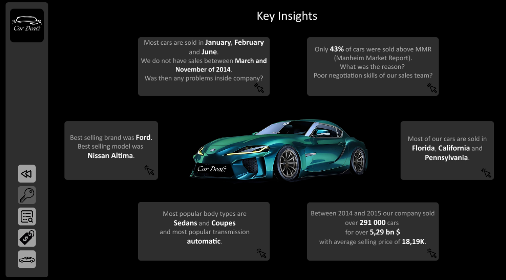
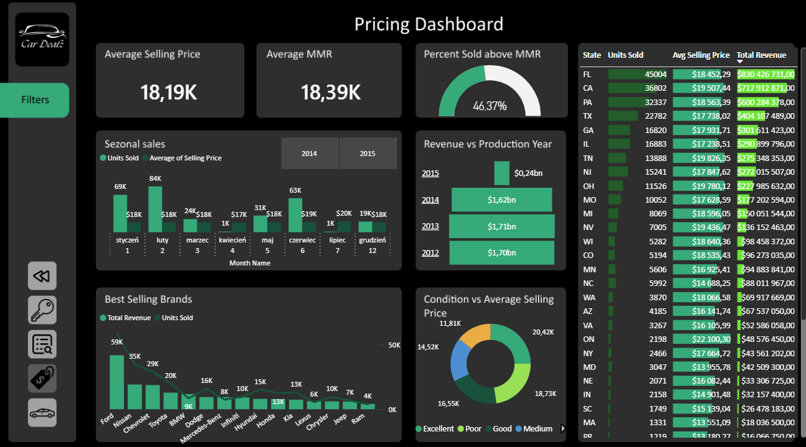
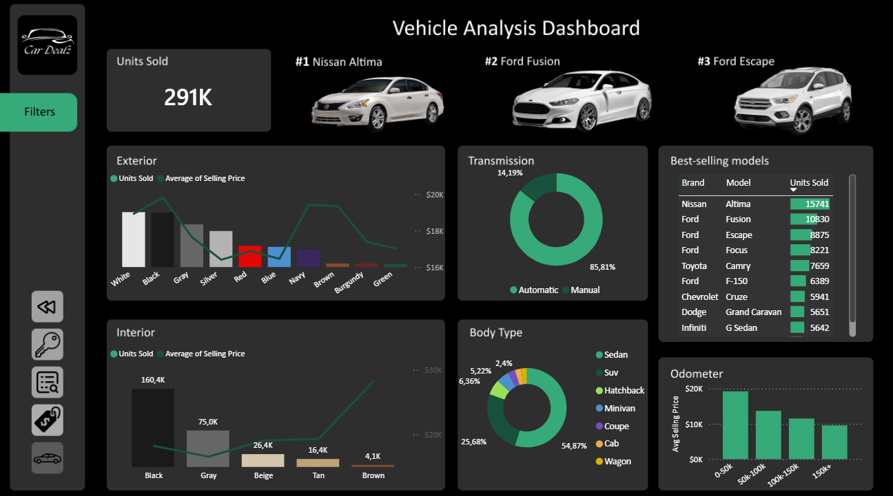

# 🚗 Used Car Sales Performance Analysis

An end-to-end data analysis project focused on exploring secondary automotive market trends, pricing strategies, and sales performance for a used car dealership chain.

---

## 📌 Interactive Demo & Screenshots

> 💡 **Live Interactive Report:** [https://app.powerbi.com/view?r=eyJrIjoiMTMyZDUxZjYtOWUyYi00YzFhLThhYWQtNDZkMmM3MmQ4ZjFkIiwidCI6IjNkZmU5YWI2LTgxYmYtNDkxYy1iNjcwLTAxYzgyNGEwOWUxOSJ9]

| Dashboard Page | Preview |
| :--- | :--- |
| **1. Key Insights** |  |
| **2. Overview Dashboard** | !Screenshot 2026-10-21 165149.png |
| **3. Pricing Dashboard** |  |
| **4. Vehicle Analysis Dashboard** |  |

---

## 💼 Business Problem

The client, a regional used car retailer, experienced fluctuating profit margins and uneven inventory turnover rates across different dealership branches. 

**Key Business Questions Addressed:**
* What factors (age, mileage, brand, transmission type) drive car pricing and sales volume?
* Which vehicle categories generate the highest profit margins vs. which sit in inventory the longest?
* How can pricing strategies be optimized to improve inventory turnover?

---

## 🛠️ Project Architecture & Workflow

### 1. Data Extraction & Filtering (SQL)
* Querying the raw database to extract relevant inventory and sales records.
* Filtering out incomplete entries, invalid price outliers, and test records.
* Aggregate metrics at a monthly and regional level prior to importing.
* *The SQL query used for data preparation can be found in [`/scripts/data_filtering.sql`](./scripts/data_filtering.sql).*

### 2. Data Modeling & Analysis (Power BI)
* Created a star schema data model connecting Sales, Inventory, Vehicles, and Calendar tables.
* Authored DAX measures for dynamic KPIs (e.g., *Total Revenue, Average Price, Days in Inventory, MoM Sales Growth*).
* Designed clean, user-centric visual interfaces focusing on UX/UI design best practices.

---

## 📊 Dashboard Structure

The Power BI report consists of **4 distinct interactive pages**:

1. **Key Insights:** Executive-level overview summarizing critical business performance metrics and strategic recommendations at a glance.
2. **Overview Dashboard:** High-level view of revenue trends, total units sold, regional branch comparisons, and target achievement tracking.
3. **Pricing Dashboard:** In-depth analysis of vehicle valuation, price distribution, mileage depreciation rates, and profit margins by brand/segment.
4. **Vehicle Analysis Dashboard:** Granular drill-down into specific car makes, models, body types, fuel types, and inventory age.

---

## 💡 Key Business Insights

* **Top Revenue Drivers:** SUV and Hybrid models showed the highest Year-over-Year (YoY) revenue growth, outperforming traditional sedans by **15%**.
* **Depreciation & Mileage Threshold:** Cars with over **100,000 km** experience a sharp drop in listing price (~22%), but their average days in inventory increase by **12 days**.
* **Inventory Turnover:** Diesel vehicles aged between 3 to 5 years had the fastest inventory turnover rate (average of **18 days on the lot**).
* **Pricing Opportunity:** Premium segment vehicles were consistently underpriced by **4–6%** compared to market benchmarks, indicating an opportunity for margin optimization.
