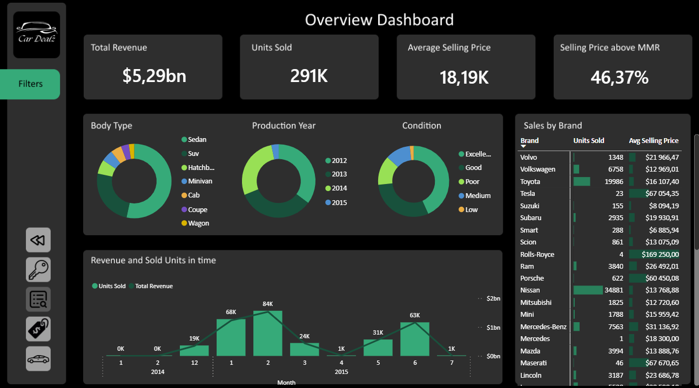

# 🚗 Used Car Sales Performance Analysis

An end-to-end data analysis project focused on exploring secondary automotive market trends, pricing strategies, and sales performance for a used car dealership chain. I used data for fictional company called "Car Dealz". 

---

## 📌 Interactive Demo & Screenshots

> 💡 **Live Interactive Report:** [https://app.powerbi.com/view?r=eyJrIjoiMTMyZDUxZjYtOWUyYi00YzFhLThhYWQtNDZkMmM3MmQ4ZjFkIiwidCI6IjNkZmU5YWI2LTgxYmYtNDkxYy1iNjcwLTAxYzgyNGEwOWUxOSJ9]

| Dashboard Page | Preview |
| :--- | :--- |
| **1. Key Insights** |  |
| **2. Overview Dashboard** |  |
| **3. Pricing Dashboard** |  |
| **4. Vehicle Analysis Dashboard** |  |

---

## 💼 Business Problem

The client, a national used car retailer, experienced fluctuating profit margins and uneven inventory turnover rates across different dealership branches. 

**Key Business Questions Addressed:**
* What factors (age, mileage, brand, transmission type) drive car pricing and sales volume?
* Which vehicle categories generate the highest profit margins?
* Does the company is able to sell cars above their MMR (Manheim Market Report) evaluations?
* How can pricing strategies be optimized to improve inventory turnover?

---

## 🛠️ Project Architecture & Workflow

### 1. Data Extraction & Filtering (SQL)
* Querying the raw database to extract relevant sales records.

### 2. Data Modeling & Analysis (Power BI)
* Created a Calendar table and a Measures table containing all DAX measures.
* Authored DAX measures for dynamic KPIs (e.g., *Total Revenue, Average Selling Price, Units Sold, %Sold above MMR*).
* Designed clean, user-centric visual interfaces focusing on UX/UI design best practices.

---

## 📊 Dashboard Structure

The Power BI report consists of **4 distinct interactive pages** and one Landing Page:

1. **Landing Page:** Explains the main purpose of the report to the user.
2. **Key Insights:** Executive-level overview summarizing critical business performance metrics and strategic recommendations at a glance.
3. **Overview Dashboard:** High-level view of revenue trends, total units sold, brands comparisons, and sales in time.
4. **Pricing Dashboard:** In-depth analysis of vehicle valuation, price distribution,sezonality of sales, and regional profits comparision.
5. **Vehicle Analysis Dashboard:** Granular drill-down into specific car makes, models, body types, fuel types, and inventory age.

---

## 💡 Key Business Insights

* **Top Car Types:** Best selling models were traditional **Sedans** and **SUVs** responsible for **55%** and **26%** of Total Sales accordingly.
* **Sales sezonality:** most cars are sold in January, February and June.
* **Selling price:** Only **43%** of vehicles were sold above MMR estimates, meaning the company is selling cars belowe their market value.
